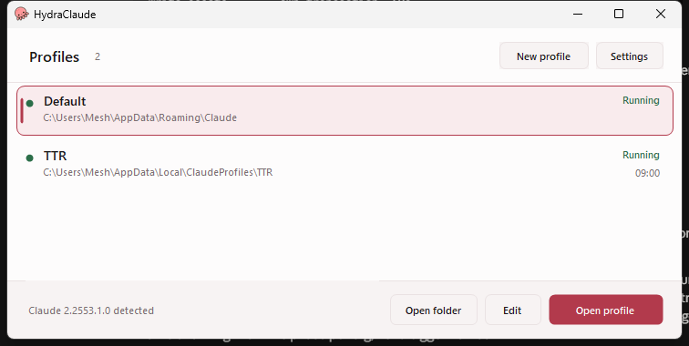
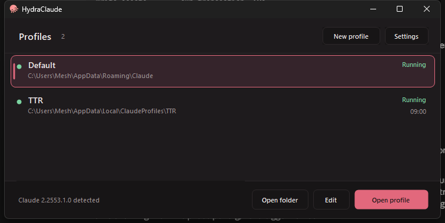

<div align="center">


# HydraClaude

**Run several Claude Desktop profiles side by side on Windows — and keep them working across
every Claude auto-update.**

[](https://github.com/Meshydra/hydraclaude/releases/latest)
[](#requirements)
[](https://ko-fi.com/meshydra)

</div>



Claude Desktop gives you one login. HydraClaude gives you as many as you want — work, personal,
a client account — each with its own history, settings and window, switchable from the
notification area.

---

## Why this needs an app at all

Claude Desktop ships as an **MSIX package**, which makes two things awkward:

1. **You cannot just make a shortcut.** The exe under `C:\Program Files\WindowsApps` refuses to
   start directly — always *"Access is denied"*, whatever the file's ACL says. A packaged app
   has to be **activated** through its package identity (AUMID), and activation is also the only
   way to pass `--user-data-dir`, which is what actually separates one profile from another.
2. **It auto-updates.** Every update changes the install path and the package full name, so
   anything that pins a path breaks at the next release.

HydraClaude handles both:

- it activates Claude by AUMID through `IApplicationActivationManager`, never by path;
- it **re-resolves the AUMID from the installed package every time it runs**
  (`FindPackagesByPackageFamily` → `GetPackageApplicationIds`), so a new Claude version changes
  nothing;
- nothing it owns lives inside the package — the exe, its config and all profile data sit in
  `%LOCALAPPDATA%\ClaudeProfiles`, which an app update never touches.

Result: install it once and forget it. No re-pointing shortcuts after an update.

## Install

1. Download `HydraClaude-win-x64.zip` from the [latest release][latest].
2. Unzip it into `%LOCALAPPDATA%\ClaudeProfiles` (create the folder if it isn't there).
3. Run `HydraClaude.exe`.

It's a single 190 KB exe plus three `.ico` files — no installer, no runtime to fetch, nothing
written outside that folder. To uninstall, delete the folder.

> Keep the `.ico` files next to the exe: they're loaded at runtime for the window and the
> theme-aware notification-area icon.

[latest]: https://github.com/Meshydra/hydraclaude/releases/latest

## Requirements

- Windows 10 or 11
- Claude Desktop installed (the MSIX/Store build — the normal one)
- .NET Framework 4.x, which ships with Windows

## Use

The window is one card: header, list, footer, and exactly one primary action.

| Action | What happens |
| --- | --- |
| **Open profile** (or double-click / <kbd>Enter</kbd>) | Launches Claude with `--user-data-dir` set to that profile's folder |
| **New profile** | Name, data folder, and any extra Electron args |
| **Edit** / **Open folder** | Repoint a profile, or open its data folder in Explorer |
| Right-click a row | The above, plus *Create desktop shortcut* and *Remove* |
| **Settings** | Package family / AUMID override, with a *Detect now* readout |

<kbd>Enter</kbd> opens · <kbd>↑</kbd><kbd>↓</kbd> navigate · <kbd>Ctrl</kbd>+<kbd>N</kbd> new ·
<kbd>F2</kbd> edit · <kbd>Del</kbd> remove · <kbd>F5</kbd> refresh · <kbd>Esc</kbd> hides to the
notification area.

Rows marked **Running** already have a window open. That's read from the command lines of the
live `claude.exe` processes, so it's right even for windows HydraClaude didn't start.

A **Default** entry is always present: it launches with no `--user-data-dir`, i.e. your normal
installation, whose data lives in `%APPDATA%\Claude`.

### Notification area

Closing the window parks the app by the hidden-icons arrow rather than quitting — a one-time
balloon says so. Right-click the tray icon to launch any profile straight from there;
**Exit HydraClaude** is the real quit. Only one manager runs at a time; launching it again wakes
the parked one.

### Command line

```
HydraClaude.exe            # manager window
HydraClaude.exe Work       # launch the "Work" profile directly — what shortcuts call
HydraClaude.exe --gui      # force the window even with other args
```

An unknown profile name is created on the spot under `%LOCALAPPDATA%\ClaudeProfiles\<name>`, so
a hand-made shortcut always works. The direct-launch path deliberately touches no UI, no WMI and
no theme code.

## Dark mode

Follows the Windows setting, title bar included, and swaps live when you change it.



## Icons


| File | Used for |
| --- | --- |
| `hydra.ico` | exe, window, taskbar, shortcuts — colour, transparent, 16–256px |
| `hydra-tray-light.ico` | notification area on a **light** taskbar — near-black glyph |
| `hydra-tray-dark.ico` | notification area on a **dark** taskbar — white glyph |

All three are generated from `assets/octopus-source.png` by `tools/make_icons.py` (Python +
Pillow). The pink plate is removed by flood-filling the background colour in from the border,
and edge pixels are un-premultiplied against it rather than hard-keyed — that's what stops a
pink fringe appearing on a dark taskbar. The tray glyph is a solid silhouette with the eyes
punched back out: line art disappears at 16px, a silhouette with holes still reads as an
octopus. The right glyph is chosen at runtime from the Windows theme.

## Performance

The app is idle almost all of its life, so the cost of doing nothing is the number that matters.

| | measured |
| --- | --- |
| Full `Win32_Process` command-line scan | **40.6 ms** |
| Plain `claude.exe` process count | **2.7 ms** |
| Idle tick with nothing changed | **2.7 ms** |

Reading a command line forces WMI into every process's PEB, so it can't run on a timer. The
process count is one syscall and only moves when a window opens or closes, so it gates the
expensive query — an idle poll is ~15× cheaper. On top of that:

- the poll timer stops entirely while the window is hidden in the tray;
- the scan runs on a thread-pool thread and only touches the UI when the answer changed;
- the list is owner-drawn and double-buffered, hover repaints only the two rows that changed,
  and every font, brush and pen is created once rather than per paint;
- `System.Management` is never loaded on the direct-launch path.

## Build

No SDK, no NuGet, no build tooling — it compiles with the .NET Framework compiler that ships
with Windows.

```bat
build.cmd
```

That writes `HydraClaude.exe` and the icons to `%LOCALAPPDATA%\ClaudeProfiles`. Regenerate the
icons from the artwork only when it changes:

```bat
python tools\make_icons.py
```

| File | |
| --- | --- |
| `HydraClaude.cs` | config store, package/AUMID resolution, activation, process scan, shortcuts |
| `Theme.cs` | palette, type scale, Windows light/dark detection, dark title bar |
| `Controls.cs` | the owner-drawn profile list and button |
| `HydraClaudeUi.cs` | manager window, tray, dialogs, entry point |
| `tools/make_icons.py` | artwork → the three icons |

## Config

`%LOCALAPPDATA%\ClaudeProfiles\hydraclaude.json` — plain, indented, hand-editable:

```json
{
  "schema": 1,
  "packageFamilyName": "Claude_pzs8sxrjxfjjc",
  "aumidOverride": "",
  "trayHintShown": true,
  "profiles": [
    { "name": "Default", "dir": "", "extraArgs": "", "lastLaunched": "" },
    { "name": "Work", "dir": "C:\\Users\\you\\AppData\\Local\\ClaudeProfiles\\Work",
      "extraArgs": "", "lastLaunched": "2026-09-22T03:30:46.9224393Z" }
  ]
}
```

Writes are atomic (temp file + `File.Replace`), and a config that fails to parse is moved aside
as `hydraclaude.json.bad` rather than blocking a launch. On first run the file doesn't exist:
HydraClaude seeds it from whatever profile folders are already in `%LOCALAPPDATA%\ClaudeProfiles`,
plus the stock entry.

`HYDRACLAUDE_THEME=light|dark` forces a palette without touching the Windows setting.

## If Claude ever stops launching

The footer says where the AUMID came from — *"Claude 2.x.y detected"* is the healthy state. If it
ever reads *"Claude not detected"*, the package family changed. Run:

```powershell
Get-StartApps | ? Name -like "*laude*"
```

and paste the AppID into **Settings → AUMID override**. No rebuild needed.

## Notes from building this

Things that aren't obvious, each of which cost a debugging round:

- `GetPackageApplicationIds` returns **complete AUMIDs** (`Claude_pzs8sxrjxfjjc!Claude`), not
  bare application ids — prefixing the family again gives a double-prefixed string that fails to
  activate. The Claude package declares three apps (`Claude`, `SshAskpass`, `SshProxy`), so the
  right one has to be picked by name.
- The Claude **main** process carries no `--user-data-dir` on its command line even when it was
  started with one. Only the child processes (renderer, gpu, utility) show the path Electron
  resolved — including the stock instance, which appears as `%APPDATA%\Claude`.
- A raw `WM_CLOSE` arrives as `CloseReason.None`, **not** `UserClosing`. A close-to-tray app that
  only tests for `UserClosing` quietly exits instead of hiding.
- `Process.MainWindowHandle` is 0 for any form with `ShowInTaskbar = false`, which is every
  dialog here — enumerate the process's windows instead if you script against them.
- WinForms paints `BorderStyle.FixedSingle` with the system frame colour, which glares against a
  dark palette. The text fields here are borderless inside a panel that draws its own rounded
  hairline.

## Design

Built against [awesome-ux-skills](https://github.com/tommyjepsen/awesome-ux-skills) — mainly
`craft`, `dieter-rams-principles`, `cognitive-load-conversion` and `ux-heuristics-review`:
one primary action instead of a rail of equal buttons; warm neutrals on a 4px spacing scale with
four type sizes and no pure `#000`/`#fff`; hairline borders and rounded cards as the single
elevation language, no shadows and no glow; hover, focus-visible, active, disabled and empty
states all designed; a *Remove* that keeps your files unless you tick the box, and then only to
the Recycle Bin. No motion anywhere — correct at 120–250ms, but pure cost on a launcher you open
for two seconds.

---

<div align="center">

Useful? [Buy me a coffee ☕](https://ko-fi.com/meshydra)

</div>
